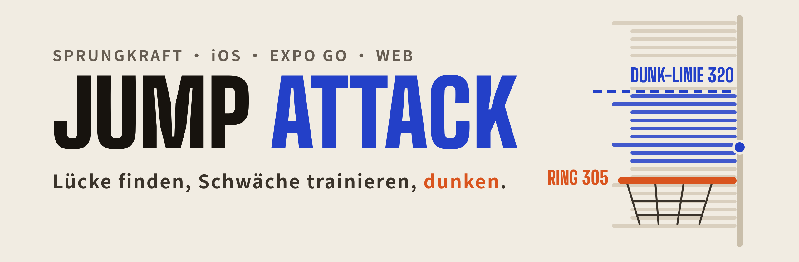
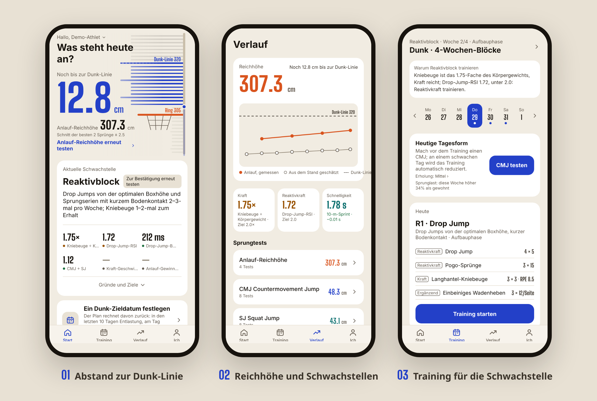
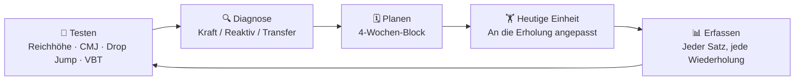
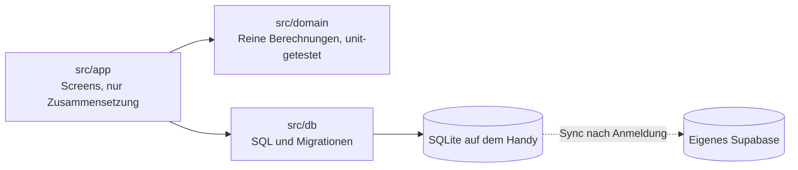

<div align="center">

<sub><a href="README.md">中文</a> · <a href="README.en.md">English</a> · <b>Deutsch</b></sub>



<p>
<a href="https://sam18069272581.github.io/jump-attack/intro/"></a>
<a href="https://sam18069272581.github.io/jump-attack/"></a>


</p>

<table>
<tr>
<td align="center" width="25%"><h3>320 cm</h3>Dunk-Linie<br><sub>Ring 305 + 15 darüber, anpassbar</sub></td>
<td align="center" width="25%"><h3>4 Kernbereiche</h3>Sprung · Sprint · VBT · Erholung<br><sub>Beweglichkeit und Ausdauer unter „Ergänzend“</sub></td>
<td align="center" width="25%"><h3>3 Blocktypen</h3>Kraft · Reaktiv · Transfer<br><sub>Nach Diagnose gewählt, je 4 Wochen</sub></td>
<td align="center" width="25%"><h3>0 Drittanbieter</h3>Keine Analytics, kein Tracking<br><sub>Cloud-Backup nur ins eigene Konto</sub></td>
</tr>
</table>

**[Warum](#warum) · [Loslegen](#loslegen) · [Funktionen](#funktionen) · [Projektstruktur](#projektstruktur) · [Entwicklung](#entwicklung)**

</div>

---

<p align="center">
  
</p>

<p align="center"><sub>Die Screenshots zeigen einen Demo-Athleten. Die App folgt der Sprache des Handys (Chinesisch, Englisch oder Deutsch); umstellen unter Ich → Sprache.</sub></p>

## Warum

Wer an seiner Sprungkraft arbeitet, weiß oft nicht, **ob es an Maximalkraft oder an Reaktivkraft fehlt**, und der Plan ändert sich nicht, wenn sich die Testergebnisse ändern. Jump Attack macht daraus einen geschlossenen Kreislauf, in dem jeder Schritt auf ein Ziel zielt: den Dunk.

Die App beantwortet drei Fragen: **Wie weit bin ich von der Dunk-Linie entfernt, woran liegt es, und was trainiere ich heute?** Die Reichhöhe des Autors mit Anlauf liegt aktuell bei etwa 318 cm, das Ziel ist ein sauberer Dunk ohne Gegenspieler vor Dezember. Danach richtet sich jede Abwägung: Genauigkeit vor Funktionsumfang, Erfassen muss mühelos sein, und keine Daten dürfen verloren gehen.



Die Diagnoseregeln passen in eine Tabelle:

| Prüfen | Unter Zielwert | Trainieren |
|---|---|---|
| Kniebeuge-1RM ÷ Körpergewicht | < 1,5 | **Kraftblock** |
| Drop-Jump-RSI, Bodenkontaktzeit | RSI < 2,0 oder Kontakt > 250 ms | **Reaktivblock** |
| Beide im Zielbereich | | **Transferblock** (Kraft in Sprunghöhe umsetzen) |

Eine Diagnose zählt erst, wenn die letzten beiden Tests übereinstimmen. Woche 4 ist eine Entlastungswoche mit Retest, und eine neue Diagnose schlägt einen neuen Block vor.

## Loslegen

Drei Wege, **keiner braucht Xcode oder ein Entwicklerkonto**:

| Weg | Geeignet für | So geht’s |
|---|---|---|
| 🌐 **Web-App** | Kurz reinschauen, vorführen | **[sam18069272581.github.io/jump-attack](https://sam18069272581.github.io/jump-attack/)** in Safari auf dem iPhone öffnen, dann Teilen → Zum Home-Bildschirm, um sie im Vollbild zu nutzen |
| 📱 **Expo Go Cloud-Build** | Tägliche Nutzung ohne Computer | In Expo Go mit dem eigenen Expo-Konto anmelden und `exp://u.expo.dev/589a8a7c-8269-46a9-a6f1-a9fa25be2636?channel-name=main` öffnen |
| 💻 **Vom Computer** | Code ändern, einen Branch testen | Siehe den eingeklappten Abschnitt unten |

GitHub Actions aktualisiert Web-App und Cloud-Build, sobald Code in `main` gemergt wird. Jeder Weg speichert seine eigenen Daten. Mit derselben E-Mail unter Ich → Sicherung und Synchronisierung angemeldet, synchronisieren sie sich untereinander.

<details>
<summary><b>💻 Vom Computer starten (mit Expo Go scannen)</b></summary>

<br>

1. **Expo Go** aus dem App Store aufs iPhone laden, [Node.js](https://nodejs.org) LTS auf den Computer.
2. [main.zip](https://github.com/Sam18069272581/jump-attack/archive/refs/heads/main.zip) herunterladen und entpacken (vor einem erneuten Download den alten Ordner `jump-attack-main` löschen).
3. Im Terminal nach `jump-attack-main/mobile` wechseln, `npm install` und dann `npm start` ausführen.
4. Handy und Computer ins selbe WLAN bringen und den QR-Code im Terminal mit der Kamera scannen.

</details>

<details>
<summary><b>Startet nicht?</b></summary>

<br>

- Campusnetze wie eduroam isolieren Geräte: Handy-Hotspot nutzen oder `npx expo start --go --tunnel` ausführen.
- In In-App-Browsern wie WeChat und QQ öffnet sich die Web-App nicht, bitte Safari nutzen. Die Web-App kann Videos nur aus der Fotomediathek importieren, und die Bild-für-Bild-Markierung ist ungenauer als in der App.
- Expo Go meldet eine abweichende SDK-Version: Maßgeblich ist die Meldung auf dem Handy, das Projekt muss mit aktualisiert werden.
- Der Cloud-Build öffnet nur Projekte des eigenen Kontos (oder der eigenen Organisation).

</details>

## Funktionen

| Bereich | Was gemessen wird | Wie |
|---|---|---|
| 🏀 **Dunk-Diagnose** | Zentimeter bis zur Dunk-Linie, aktuelle Schwäche, voraussichtliches Datum, echte Dunk-Versuche | Ganz oben auf dem Startbildschirm, fasst alle Tests darunter zusammen; Zieldatum unter Ich setzen, der Plan wird mit Tapering darauf ausgerichtet; am Korb jeden Versuch antippen: getroffen, Ring berührt oder zu kurz |
| ⬆️ **Sprungtests** | CMJ, SJ, einbeiniger CMJ, Reichhöhe mit Anlauf, optimale Drop-Jump-Kastenhöhe, 10/5-Reboundtest, Kraft-Geschwindigkeits-Profil | Der Testtag-Assistent führt durch CMJ → Drop Jump → Reichhöhe, mehrere Videos auf einmal aus der Mediathek; Clip zuschneiden, Athleten antippen, und jeder Sprung wird automatisch erkannt, mit Sprunghöhe, Bodenkontaktzeit, RSI, RSR, DRI und Konstanz, jeweils mit Fehlerangabe; ungültige Sprünge werden mit Filmtipps verworfen; Wiedergabe und Export als Hochformat-Video mit Werten; oder manuell eintragen |
| ⏱ **Sprint** | 10 / 30 / 50 / 100 m | Bild für Bild aus Zeitlupe, oder manuell von Lichtschranke oder Stoppuhr (getrennt verglichen) |
| 🏋️ **VBT** | Hantelgeschwindigkeit bei Kniebeuge, Power Clean, High Pull und Squat Jump | Werte eines Messgeräts eintragen oder die Übung filmen, um den Hantelweg zu bestimmen; schätzt das Kniebeuge-1RM |
| 💚 **Erholung** | HRV, Ruhepuls, Schlaf, Atemfrequenz | Manuell eintragen oder per Kurzbefehl aus Apple Health importieren |
| 🗓 **Training** | 4-Wochen-Blöcke, heutige Einheit, Trainingsbericht, Sprungzahl und Knieschmerz, Trainingslast, Übungsdemos | Vor dem Training 3 CMJs, gemittelt, an schlechten Tagen wird automatisch reduziert; nach der Einheit Session-RPE antippen und sehen, wie die Wochenlast im Vergleich zum Üblichen liegt; Knie bewerten, bei Schmerzen gibt es beim nächsten Mal weniger Sprünge; verpasste Einheiten an Ruhetagen nachholen; jede Übung mit Skizze und Hinweisen, oder mit eigenem Video |
| 📈 **Verlauf** | Zuerst die Reichhöhenkurve, dazu Trends und vollständige Logs aller anderen Werte | Nur Veränderungen über der kleinsten bedeutsamen Veränderung zählen als Fortschritt; Fehleinträge lassen sich bearbeiten oder löschen |
| ☁️ **Backup** | Die gesamte Datenbank im eigenen Cloud-Konto | Synchronisiert automatisch nach E-Mail-Anmeldung; Backup-Dateien lassen sich auch exportieren und importieren |

Zwei Bereiche, die für die Sprunghöhe selbst wenig bringen, liegen unter „Ergänzend“ auf dem Startbildschirm: 🧘 **Beweglichkeit** (Sprunggelenk, Hüfte, Oberschenkelrückseite, Brustwirbelsäule, Schulter, mit dem Handy als Winkelmesser) und 🔁 **Ausdauer** (Yo-Yo IR1, Cooper, RSA 6×(20+20 m), mit Audiosignalen der App).

## Projektstruktur

```
jump-attack/
├── mobile/                 Die App (Expo + React Native); alle Befehle hier ausführen
│   ├── src/
│   │   ├── app/            Screens (expo-router): Start, Training, Verlauf, Ich und jeder Testbereich
│   │   ├── domain/         Reine Berechnungen: Sprunghöhe, RSI, Kraft-Geschwindigkeit, 1RM, Diagnose, Blöcke, Bereitschaft
│   │   ├── db/             SQLite-Zugriffe und Migrationen (nur anhängen, nie ändern)
│   │   ├── sync/           Cloud-Backup und Sync (Supabase)
│   │   ├── components/     Reichhöhen-Messgerät, Diagramme, Diagnosekarte, Video-Frame-Markierung u. a.
│   │   └── state/ theme/   Globaler Zustand und die „Papier-Court“-Farbpalette
│   ├── supabase/           SQL für die Cloud-Tabellen
│   └── scripts/            Web-Build
├── site/                   Produktseite (reines HTML, als /intro/ der Web-App veröffentlicht)
├── .github/workflows/      Veröffentlichen Web-App und Cloud-Build nach Merges in main
├── design/                 UI-Design-Quellen und Icons
└── docs/                   Systemdesign, Datenschutz, README-Bilder
```



## Entwicklung

```sh
cd mobile
npm install
npm start                                     # mit Expo Go scannen
npm run build:web                             # Web-App nach dist/ exportieren
npm test && npm run typecheck && npm run lint  # muss vor jedem Commit grün sein
```

Schichten, Tests und Git-Workflow (Conventional Commits, Feature-Branches, Merge-Commits) stehen in [CLAUDE.md](CLAUDE.md), Expo-Regeln in [mobile/AGENTS.md](mobile/AGENTS.md), weitere Details zum Starten in [mobile/README.md](mobile/README.md). Diese Dateien sind auf Chinesisch.

## Doku

- [Produktseite](https://sam18069272581.github.io/jump-attack/intro/): Englisch und Chinesisch, Quelltext in [site/](site/)
- [Systemdesign](docs/system-design.md) (Chinesisch): Kreislauf, Datenmodell, Open-Source-Auswahl
- [UI-Design](https://claude.ai/artifact/TdA5bEMuYhctBQhrrQeKv9): Quellen in [design/](design/)
- [Datenschutz](docs/privacy.md) (Chinesisch)

<div align="center">
<br>
<sub>Planaufbau angelehnt an <a href="https://github.com/astashov/liftosaur">Liftosaur</a> · Kraft-Geschwindigkeits-Profil nach Samozinos vereinfachter Methode · Sprunghöhe aus Flugzeit h = g·t²/8</sub>
</div>
