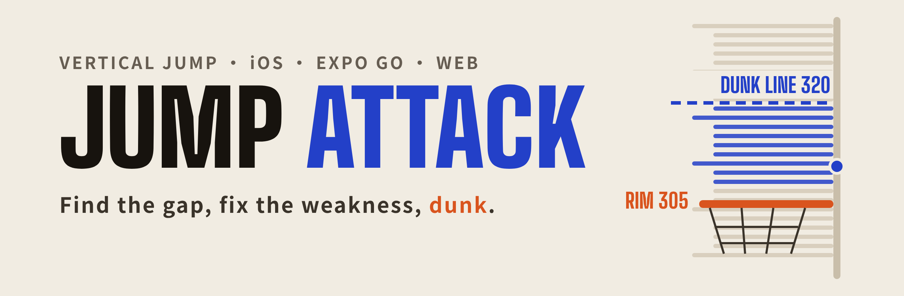
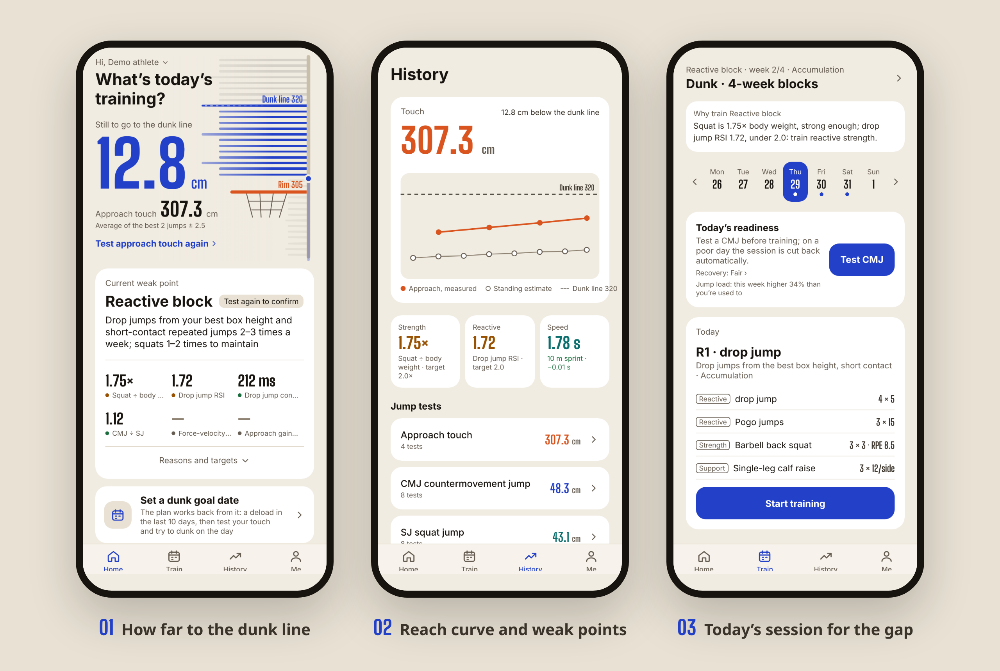
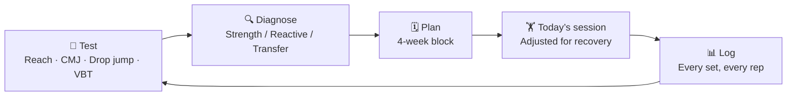
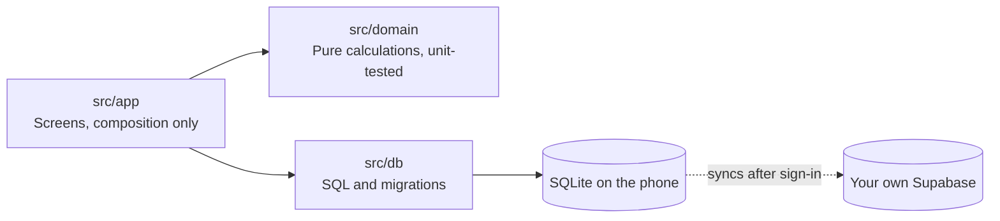

<div align="center">

<sub><a href="README.md">中文</a> · <b>English</b> · <a href="README.de.md">Deutsch</a></sub>



<p>
<a href="https://sam18069272581.github.io/jump-attack/intro/"></a>
<a href="https://sam18069272581.github.io/jump-attack/"></a>


</p>

<table>
<tr>
<td align="center" width="25%"><h3>320 cm</h3>Dunk line<br><sub>Rim 305 + 15 above it, adjustable</sub></td>
<td align="center" width="25%"><h3>4 core sections</h3>Jump · Speed · VBT · Recovery<br><sub>Mobility and conditioning live under “Support”</sub></td>
<td align="center" width="25%"><h3>3 block types</h3>Strength · Reactive · Transfer<br><sub>Chosen by diagnosis, 4 weeks each</sub></td>
<td align="center" width="25%"><h3>0 third parties</h3>No analytics, no tracking<br><sub>Cloud backup goes to your own account only</sub></td>
</tr>
</table>

**[Why](#why) · [Getting started](#getting-started) · [Features](#features) · [Project structure](#project-structure) · [Development](#development)**

</div>

---

<p align="center">
  
</p>

<p align="center"><sub>Screens show a demo athlete. The app follows the phone’s language (Chinese, English or German); change it under Me → Language.</sub></p>

## Why

People who train their vertical often don’t know **whether they lack strength or reactivity**, and their plan doesn’t change when test results do. Jump Attack turns this into one loop, with every step aimed at a single goal: the dunk.

The app answers three questions: **how far am I from the dunk line, what is holding me back, and what do I train today**. The author’s running reach is about 318 cm today, and the goal is a clean dunk with no defender before December. Every trade-off follows that goal: accuracy over feature count, logging must be effortless, and data must never be lost.



The diagnosis rules fit in one table:

| Check | Below target | Train |
|---|---|---|
| Squat 1RM ÷ body weight | < 1.5 | **Strength block** |
| Drop jump RSI, contact time | RSI < 2.0 or contact > 250 ms | **Reactive block** |
| Both on target | | **Transfer block** (turn strength into jump height) |

A diagnosis only counts when the last two tests agree. Week 4 is a deload with a retest, and a new diagnosis suggests a new block.

## Getting started

Three ways, **none of them need Xcode or a developer account**:

| Way | Best for | How |
|---|---|---|
| 🌐 **Web app** | A quick look or a demo | Open **[sam18069272581.github.io/jump-attack](https://sam18069272581.github.io/jump-attack/)** in Safari on iPhone, then Share → Add to Home Screen to run it full screen |
| 📱 **Expo Go cloud build** | Daily use without a computer | Sign in to Expo Go with your Expo account and open `exp://u.expo.dev/589a8a7c-8269-46a9-a6f1-a9fa25be2636?channel-name=main` |
| 💻 **From your computer** | Changing code, trying a branch | See the collapsed section below |

GitHub Actions updates the web app and the cloud build whenever code is merged into `main`. Each way keeps its own data. Sign in with the same email under Me → Backup and sync to share it between them.

<details>
<summary><b>💻 Start from your computer (scan with Expo Go)</b></summary>

<br>

1. Install **Expo Go** from the App Store on iPhone, and [Node.js](https://nodejs.org) LTS on your computer.
2. Download [main.zip](https://github.com/Sam18069272581/jump-attack/archive/refs/heads/main.zip) and unzip it (delete the old `jump-attack-main` folder before downloading again).
3. In a terminal, go to `jump-attack-main/mobile`, run `npm install`, then `npm start`.
4. Put phone and computer on the same Wi-Fi and scan the QR code in the terminal with the camera.

</details>

<details>
<summary><b>Won’t open?</b></summary>

<br>

- Campus networks such as eduroam isolate devices: use your phone’s hotspot, or run `npx expo start --go --tunnel`.
- In-app browsers like WeChat and QQ can’t open the web app. Use Safari. The web app can only import videos from the photo library, and frame-by-frame marking is less precise than in the app.
- Expo Go says the SDK version doesn’t match: go by the message on your phone, the project has to be upgraded with it.
- The cloud build only opens projects from your own account (or your organization).

</details>

## Features

| Section | What it measures | How |
|---|---|---|
| 🏀 **Dunk diagnosis** | Centimetres to the dunk line, current weakness, projected date you clear it, real dunk attempts | Top of the home screen, rolling up every test below; set a target date under Me and the plan tapers back from it; at the rim, tap made, touched the rim or short for each attempt |
| ⬆️ **Jump tests** | CMJ, SJ, single-leg CMJ, running reach, best drop jump box height, 10/5 rebound test, force-velocity profile | The test-day guide walks through CMJ → drop jump → running reach, picking several videos from the camera roll at once; trim the clip, tap the athlete, and every jump is found automatically, with jump height, contact time, RSI, RSR, DRI and consistency, each with its error; invalid jumps are rejected with filming tips; replay and export a portrait video with the numbers; or type them in |
| ⏱ **Speed** | 10 / 30 / 50 / 100 m sprints | Frame by frame from slow motion, or typed in from timing gates or a stopwatch (compared separately) |
| 🏋️ **VBT** | Bar speed for squat, power clean, high pull and squat jump | Type in readings from a velocity device, or film the lift to get bar travel; estimates squat 1RM |
| 💚 **Recovery** | HRV, resting heart rate, sleep, breathing rate | Type them in, or import from Apple Health with a Shortcut |
| 🗓 **Training** | 4-week blocks, today’s session, session reports, jump count and knee pain, training load, exercise demos | Three CMJs before training, averaged, and a bad day is eased off automatically; tap a session RPE afterwards to see how this week’s load compares with usual; rate your knees after training, and sore knees mean fewer jumps next time; missed sessions can be made up on rest days; every exercise has a diagram and cues, or your own video |
| 📈 **History** | Reach curve first, trends and full logs for every other metric | Only changes above the smallest meaningful change count as progress; mistakes can be edited or deleted |
| ☁️ **Backup** | The whole database, backed up to your own cloud account | Syncs automatically after email sign-in; backup files can be exported and imported too |

Two sections that matter little for jump height itself live under “Support” on the home screen: 🧘 **Mobility** (ankle, hip, hamstrings, thoracic spine, shoulder, with the phone as a goniometer) and 🔁 **Conditioning** (Yo-Yo IR1, Cooper, RSA 6×(20+20 m), with audio cues from the app).

## Project structure

```
jump-attack/
├── mobile/                 The app (Expo + React Native); run every command here
│   ├── src/
│   │   ├── app/            Screens (expo-router): home, training, history, me, and each test section
│   │   ├── domain/         Pure calculations: jump height, RSI, force-velocity, 1RM, diagnosis, blocks, readiness
│   │   ├── db/             SQLite reads, writes and migrations (append-only, never edited)
│   │   ├── sync/           Cloud backup and sync (Supabase)
│   │   ├── components/     Reach tester, charts, diagnosis card, video frame marking and more
│   │   └── state/ theme/   Global state and the “paper court” palette
│   ├── supabase/           Cloud table SQL
│   └── scripts/            Web build
├── site/                   Product page (plain HTML, published to /intro/ on the web app)
├── .github/workflows/      Publish the web app and cloud build after merges into main
├── design/                 UI design sources and icons
└── docs/                   System design, privacy notes, README images
```



## Development

```sh
cd mobile
npm install
npm start                                     # scan with Expo Go
npm run build:web                             # export the web app to dist/
npm test && npm run typecheck && npm run lint  # all must pass before committing
```

Layering, testing and the Git workflow (Conventional Commits, feature branches, merge commits) are in [CLAUDE.md](CLAUDE.md), Expo rules are in [mobile/AGENTS.md](mobile/AGENTS.md), and more run details are in [mobile/README.md](mobile/README.md). These are written in Chinese.

## Docs

- [Product page](https://sam18069272581.github.io/jump-attack/intro/): English and Chinese, source in [site/](site/)
- [System design](docs/system-design.md) (Chinese): the loop, data model, open-source choices
- [UI design](https://claude.ai/artifact/TdA5bEMuYhctBQhrrQeKv9): sources in [design/](design/)
- [Privacy](docs/privacy.md) (Chinese)

<div align="center">
<br>
<sub>Plan structure borrows from <a href="https://github.com/astashov/liftosaur">Liftosaur</a> · Force-velocity profile by Samozino’s simple method · Jump height from flight time h = g·t²/8</sub>
</div>
