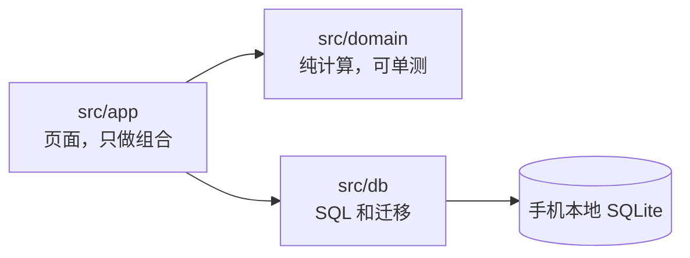

<div align="center">


### 离扣篮还差几厘米？测出来，找到短板，练回来。

<p>


</p>

<table>
<tr>
<td align="center" width="25%"><h3>320 cm</h3>扣篮线<br><sub>篮筐 305 + 过筐 15，可改</sub></td>
<td align="center" width="25%"><h3>6 个板块</h3>跳跃 · 速度 · VBT<br><sub>灵活度 · 恢复 · 体能耐力</sub></td>
<td align="center" width="25%"><h3>3 种训练块</h3>力量 · 反应 · 转化<br><sub>按诊断排，4 周一块</sub></td>
<td align="center" width="25%"><h3>0 次上传</h3>健康和训练数据<br><sub>SQLite 存在手机上</sub></td>
</tr>
</table>

**[为什么做](#为什么做) · [怎么展示](#怎么展示) · [能做什么](#能做什么) · [项目结构](#项目结构) · [开发](#开发)**

</div>

---

<p align="center">
  
</p>

## 为什么做

练弹跳的人常常不知道自己**缺的是力量还是速度**，计划也不会跟着测试结果变。Jump Attack 把这件事做成一个闭环，每一步都对准一个目标：扣篮。


诊断规则一眼能看懂：

| 先看 | 没过线 | 就练 |
|---|---|---|
| 深蹲 1RM ÷ 体重 | < 1.5 | **力量块** |
| 跳深 RSI、触地时间 | RSI < 2.0 或触地 > 250 ms | **反应块** |
| 两项都过线 | | **转化块**（把力量变成跳高） |

最近两次测试结论一致才算数；第 4 周减量并复测，诊断变了就建议换块。

## 怎么展示

只需要一台 iPhone 和一台电脑（Mac、Windows 都行），**不用 Xcode，不用开发者账号**。

1. iPhone 从 App Store 装 **Expo Go**，电脑装 [Node.js](https://nodejs.org) LTS。
2. 下载代码 [main.zip](https://github.com/Sam18069272581/jump-attack/archive/refs/heads/main.zip) 并解压（重新下载前先删掉旧的 `jump-attack-main` 文件夹）。
3. 终端进入 `jump-attack-main/mobile`，运行：

   ```sh
   npm install
   npm start
   ```

4. 手机和电脑连同一个 Wi-Fi，用相机扫终端里的二维码，App 在 Expo Go 里打开。

<details>
<summary><b>扫码后打不开？</b></summary>

<br>

- 校园网（如 eduroam）会隔离设备：改用手机热点，或运行 `npx expo start --go --tunnel`。
- Expo Go 提示 SDK 版本不匹配：以手机上的提示为准，项目要一起升级。
- 演示时电脑终端要一直开着；测试记录存在手机上，下次扫码还在。

</details>

## 能做什么

| 板块 | 测什么 | 怎么测 |
|---|---|---|
| 🏀 **扣篮诊断** | 离扣篮线还差几厘米、当前短板 | 首页最上面，汇总下面所有测试 |
| ⬆️ **跳跃测试** | CMJ、SJ、单腿 CMJ、助跑摸高、跳深最佳箱高、力-速度曲线 | 慢动作录像逐帧标起跳和落地，或手填 |
| ⏱ **速度** | 10 / 30 / 50 / 100 m 冲刺 | 慢动作逐帧，或光电门、秒表手填 |
| 🏋️ **VBT** | 深蹲、高翻、高拉、深蹲跳的杠铃速度 | 手填测速设备读数，或录像算行程；估算深蹲 1RM |
| 🧘 **灵活度** | 踝、髋、腘绳肌、胸椎、肩，左右各一次 | 手机贴在肢体上当量角器 |
| 💚 **恢复** | HRV、静息心率、睡眠、呼吸频率 | 手填，或用「快捷指令」从苹果健康导入 |
| 🔁 **体能耐力** | VO2max、反复冲刺能力 | Yo-Yo IR1、Cooper 12 分钟跑、RSA 6×(20+20 m)，App 报音 |
| 🗓 **训练** | 4 周训练块、今日训练、训练报告 | 练前测 CMJ，状态差自动减量；连续疲劳建议插入减量周 |
| 📈 **历史** | 摸高曲线为主，其他指标趋势和逐次记录 | 超过「最小有意义变化」才算真进步 |

## 项目结构

```
jump-attack/
├── mobile/                 手机 App（Expo + React Native），命令都在这里跑
│   └── src/
│       ├── app/            页面（expo-router）：首页、训练、历史、我的，以及各测试板块
│       ├── domain/         纯计算：跳高、RSI、力-速度、1RM、诊断、训练块、准备度
│       ├── db/             SQLite 读写和迁移（只追加，不改已有的）
│       ├── components/     图表、摸高尺、诊断卡、录像标帧等组件
│       └── state/ theme/   全局状态和配色
├── design/                 13 个页面的 UI 设计稿源文件和图标
└── docs/                   系统方案、隐私说明、发布步骤
```



## 开发

```sh
cd mobile
npm install
npm start                                     # Expo Go 扫码
npm test && npm run typecheck && npm run lint  # 提交前全部要过
```

协作规则（分层、先写测试、加依赖用 `npx expo install`）见 [CLAUDE.md](CLAUDE.md)，Expo 相关规则见 [mobile/AGENTS.md](mobile/AGENTS.md)。

## 文档

- [系统方案](docs/system-design.md)：闭环设计、数据模型、开源选型
- [UI 设计稿](https://claude.ai/artifact/TdA5bEMuYhctBQhrrQeKv9)：源文件在 [design/](design/)
- [隐私说明](docs/privacy.md) · [发布步骤](docs/release/README.md)

<div align="center">
<br>
<sub>计划借鉴 <a href="https://github.com/astashov/liftosaur">Liftosaur</a> · 力-速度曲线按 Samozino 简易法 · 跳高按腾空时间 h = g·t²/8</sub>
</div>
