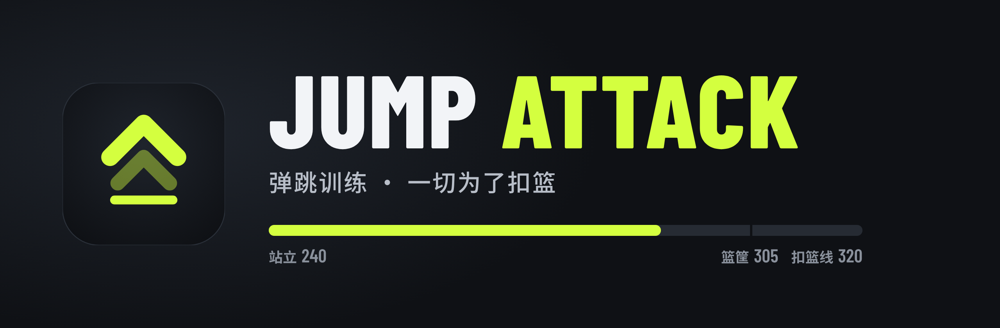
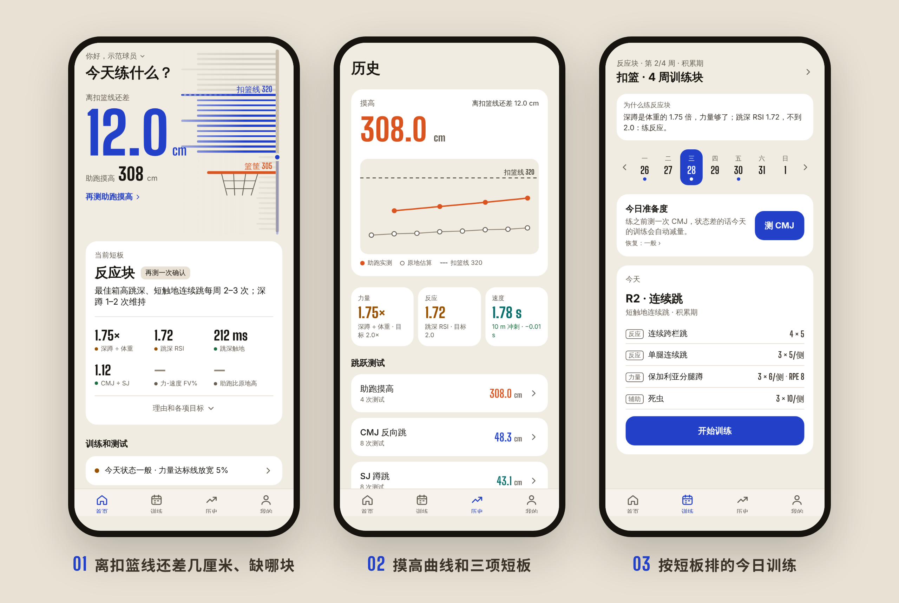
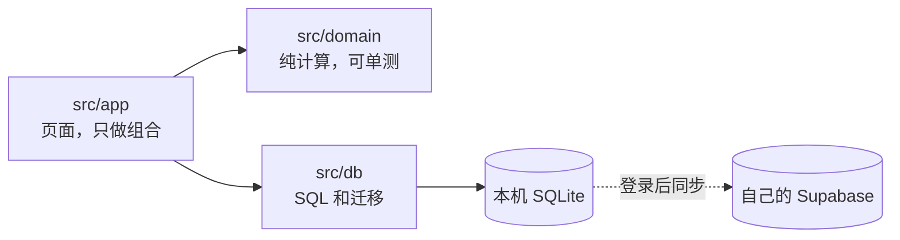

<div align="center">



<p>
<a href="https://sam18069272581.github.io/jump-attack/"></a>


</p>

<table>
<tr>
<td align="center" width="25%"><h3>320 cm</h3>扣篮线<br><sub>篮筐 305 + 过筐 15，可改</sub></td>
<td align="center" width="25%"><h3>4 个主板块</h3>跳跃 · 速度 · VBT · 恢复<br><sub>灵活度、体能耐力收在「辅助」</sub></td>
<td align="center" width="25%"><h3>3 种训练块</h3>力量 · 反应 · 转化<br><sub>按诊断排，4 周一块</sub></td>
<td align="center" width="25%"><h3>0 个第三方</h3>不加统计、不做追踪<br><sub>云备份只进你自己的账号</sub></td>
</tr>
</table>

**[为什么做](#为什么做) · [怎么打开](#怎么打开) · [能做什么](#能做什么) · [项目结构](#项目结构) · [开发](#开发)**

</div>

---

<p align="center">
  
</p>

## 为什么做

练弹跳的人常常不知道自己**缺的是力量还是反应**，计划也不会跟着测试结果变。Jump Attack 把这件事做成一个闭环，每一步都对准一个目标：扣篮。

整个 App 只回答三个问题：**离扣篮线还差多少、差在哪块、今天练什么**。作者现在助跑摸高约 318 cm，目标是 12 月前无对抗扣进第一个篮。取舍也跟着这个目标走：测得准比功能多重要，记录要省事，数据不能丢。


诊断规则一眼能看懂：

| 先看 | 没过线 | 就练 |
|---|---|---|
| 深蹲 1RM ÷ 体重 | < 1.5 | **力量块** |
| 跳深 RSI、触地时间 | RSI < 2.0 或触地 > 250 ms | **反应块** |
| 两项都过线 | | **转化块**（把力量变成跳高） |

最近两次测试结论一致才算数；第 4 周减量并复测，诊断变了就建议换块。

## 怎么打开

三种方式，**都不用 Xcode，也不用开发者账号**：

| 方式 | 适合 | 怎么开 |
|---|---|---|
| 🌐 **网页版** | 马上看一眼、给别人演示 | iPhone Safari 打开 **[sam18069272581.github.io/jump-attack](https://sam18069272581.github.io/jump-attack/)**，「分享 → 添加到主屏幕」后全屏使用 |
| 📱 **Expo Go 云端版** | 自己天天用，不开电脑 | Expo Go 登录自己的 Expo 账号，打开 `exp://u.expo.dev/589a8a7c-8269-46a9-a6f1-a9fa25be2636?channel-name=main` |
| 💻 **电脑启动** | 改代码、看最新分支 | 见下面的折叠块 |

网页版和云端版在代码合并进 `main` 后由 GitHub Actions 自动更新。三种方式各存各的数据，在「我的 → 数据备份与同步」登录同一个邮箱就能互相同步。

<details>
<summary><b>💻 用电脑启动（Expo Go 扫码）</b></summary>

<br>

1. iPhone 从 App Store 装 **Expo Go**，电脑装 [Node.js](https://nodejs.org) LTS。
2. 下载 [main.zip](https://github.com/Sam18069272581/jump-attack/archive/refs/heads/main.zip) 并解压（重新下载前先删掉旧的 `jump-attack-main` 文件夹）。
3. 终端进入 `jump-attack-main/mobile`，运行 `npm install`，再运行 `npm start`。
4. 手机和电脑连同一个 Wi-Fi，用相机扫终端里的二维码。

</details>

<details>
<summary><b>打不开？</b></summary>

<br>

- 校园网（如 eduroam）会隔离设备：改用手机热点，或运行 `npx expo start --go --tunnel`。
- 网页版在微信、QQ 内置浏览器里打不开，请用 Safari。网页版只能从相册导入视频，逐帧定位不如 App 精确。
- Expo Go 提示 SDK 版本不匹配：以手机上的提示为准，项目要一起升级。
- 云端版只能打开自己账号（或所在组织）的项目。

</details>

## 能做什么

| 板块 | 测什么 | 怎么测 |
|---|---|---|
| 🏀 **扣篮诊断** | 离扣篮线还差几厘米、当前短板、预计哪天过线、真实扣篮尝试 | 首页最上面，汇总下面所有测试；在「我的」设目标日，计划按它倒推减量；去篮下试扣，每次点一下扣进、碰框或没够到 |
| ⬆️ **跳跃测试** | CMJ、SJ、单腿 CMJ、助跑摸高、跳深最佳箱高、10/5 连跳、力-速度曲线 | 测试日向导按 CMJ → 跳深 → 助跑摸高走一遍，相册一次多选视频；框出片段、点一下运动员，自动认出每一跳，算跳高、触地、RSI、RSR、DRI 和稳定性，带误差；不合规的自动剔除并给拍摄建议；回放并导出带数据的竖屏视频；也能手填 |
| ⏱ **速度** | 10 / 30 / 50 / 100 m 冲刺 | 慢动作逐帧，或光电门、秒表手填（分开比较） |
| 🏋️ **VBT** | 深蹲、高翻、高拉、深蹲跳的杠铃速度 | 手填测速设备读数，或录像算行程；估算深蹲 1RM |
| 💚 **恢复** | HRV、静息心率、睡眠、呼吸频率 | 手填，或用「快捷指令」从苹果健康导入 |
| 🗓 **训练** | 4 周训练块、今日训练、训练报告、跳跃次数和膝盖疼痛、训练负荷 | 练前测 3 次 CMJ 取均值，状态差自动减量；练完点整节 RPE，算这周负荷比平时高多少；练完给膝盖打分，疼了下次自动少跳；漏练的课能在休息日补 |
| 📈 **历史** | 摸高曲线为主，其他指标趋势和逐次记录 | 超过「最小有意义变化」才算真进步；记错了能改能删 |
| ☁️ **备份** | 整库备份到自己的云端账号 | 邮箱登录后自动同步；也能导出、导入备份文件 |

首页「辅助」里还有两个对弹跳本身贡献小的板块：🧘 **灵活度**（踝、髋、腘绳肌、胸椎、肩，手机当量角器）和 🔁 **体能耐力**（Yo-Yo IR1、Cooper、RSA 6×(20+20 m)，App 报音）。

## 项目结构

```
jump-attack/
├── mobile/                 App（Expo + React Native），命令都在这里跑
│   ├── src/
│   │   ├── app/            页面（expo-router）：首页、训练、历史、我的，以及各测试板块
│   │   ├── domain/         纯计算：跳高、RSI、力-速度、1RM、诊断、训练块、准备度
│   │   ├── db/             SQLite 读写和迁移（只追加，不改已有的）
│   │   ├── sync/           云端备份与同步（Supabase）
│   │   ├── components/     摸高器、图表、诊断卡、录像标帧等组件
│   │   └── state/ theme/   全局状态和「纸面球场」配色
│   ├── supabase/           云端建表 SQL
│   └── scripts/            网页版打包
├── .github/workflows/      合并进 main 后自动发布网页版和云端版
├── design/                 UI 设计稿源文件和图标
└── docs/                   系统方案、隐私说明、README 图片
```



## 开发

```sh
cd mobile
npm install
npm start                                     # Expo Go 扫码
npm run build:web                             # 网页版导出到 dist/
npm test && npm run typecheck && npm run lint  # 提交前全部要过
```

分层、测试和 Git 工作流（Conventional Commits、功能分支、Squash 合并）见 [CLAUDE.md](CLAUDE.md)，Expo 相关规则见 [mobile/AGENTS.md](mobile/AGENTS.md)，更多运行细节见 [mobile/README.md](mobile/README.md)。

## 文档

- [系统方案](docs/system-design.md)：闭环设计、数据模型、开源选型
- [UI 设计稿](https://claude.ai/artifact/TdA5bEMuYhctBQhrrQeKv9)：源文件在 [design/](design/)
- [隐私说明](docs/privacy.md)

<div align="center">
<br>
<sub>计划借鉴 <a href="https://github.com/astashov/liftosaur">Liftosaur</a> · 力-速度曲线按 Samozino 简易法 · 跳高按腾空时间 h = g·t²/8</sub>
</div>
